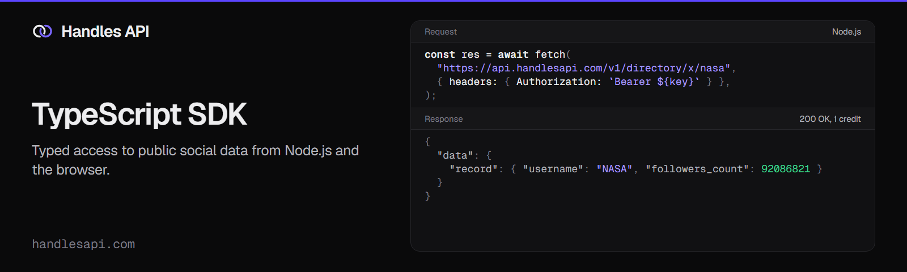
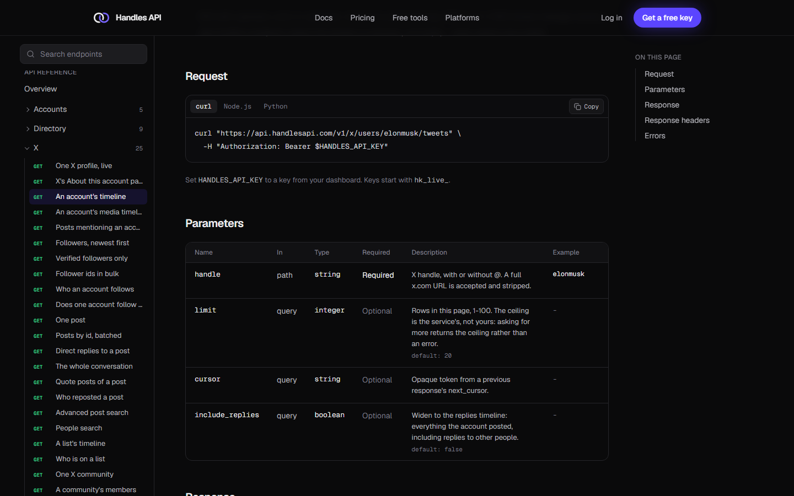

# handlesapi-js

`handlesapi-js` is the TypeScript client for [Handles API](https://handlesapi.com), a REST and MCP API that returns public data from X (Twitter), Instagram, TikTok, YouTube, Telegram, Bluesky, Twitch, Kick and LinkedIn companies in one consistent JSON shape. It has no runtime dependencies (it uses `fetch`), ships ESM and CommonJS builds, and types all 113 endpoints from the [OpenAPI spec](https://github.com/handlesapi/openapi).

## Why

- No runtime dependencies: it uses `fetch`, so it runs on Node 18+, Deno, Bun and Cloudflare Workers.
- Every one of the 113 endpoints is a typed method, generated from the OpenAPI spec by the generator in this repo, so the client and the API cannot drift silently.
- The things you would otherwise write yourself are built in: `X-Credits-*` parsing, `Retry-After` handling, backoff for transient failures, cursor pagination and typed errors.

## Quickstart

### Install

The package is not published to npm yet. Install it straight from GitHub; the build runs on install:

```bash
npm install github:handlesapi/handlesapi-js
```

Requires Node 18 or newer (or any runtime with `fetch`: Deno, Bun, Cloudflare Workers).

### First call

Get an API key at [handlesapi.com/signup](https://handlesapi.com/signup). The Free plan gives you 100 credits to try every endpoint, once, with no card. Keep the key on the server: it spends your credits.

```ts
import { HandlesApi } from "handlesapi";

const api = new HandlesApi({ apiKey: process.env.HANDLES_API_KEY });

// Catalog check: 1 credit.
const { data, credits } = await api.accountsCheck({ platform: "youtube", handle: "mrbeast" });
console.log(data.identity?.name, data.audience?.count, data.audience?.metric);
console.log(`credits left: ${credits.remaining}`);

// Live read of an X timeline: 2 credits.
const tweets = await api.xUsersTweets({ handle: "nasa", limit: 5 });
for (const t of tweets.data.tweets ?? []) console.log(t.likes, t.text);
```

If you omit `apiKey`, the client reads `HANDLES_API_KEY` from the environment.

## Endpoints



Every endpoint has a typed method named after its `operationId` in camelCase. Path, query and body parameters all go in a single object, and the `data` of every response is typed.

| Endpoint | Method |
| --- | --- |
| `GET /accounts/{platform}/{handle}` | `api.accountsCheck({ platform, handle })` |
| `POST /accounts/check` | `api.accountsBulk({ targets })` |
| `GET /directory/search` | `api.directorySearch({ q })` |
| `GET /x/users/{handle}/tweets` | `api.xUsersTweets({ handle, limit })` |
| `GET /insights/instagram/{handle}/top-posts` | `api.insightsInstagramTopPosts({ handle })` |
| `GET /trends/{platform}/movers` | `api.trendsMovers({ platform })` |
| `GET /leads/linkedin/companies` | `api.leadsLinkedinCompaniesList({ country })` |

The full list, with credit costs, is in [`src/generated/operations.ts`](src/generated/operations.ts) and in the [API reference](https://handlesapi.com/docs/reference). `api.operation(name, params)` calls any endpoint by name, and `api.requestRaw({ method, path, query, body })` reaches anything else.

## Pricing and credits

Catalog, insights, identity and lead reads cost 1 credit; live reads cost 2. Plans: Free (100 credits, once, no card), Starter ($29 a month, 15,000 credits), Pro ($99, 75,000), Business ($299, 300,000), Scale ($799, 1,200,000). See [Credits and limits](https://handlesapi.com/docs/credits-and-limits) and [pricing](https://handlesapi.com/pricing).

### Credits and rate limits in code

Each response carries the credit and rate-limit headers, parsed for you:

```ts
const res = await api.accountsPlatforms({});
res.credits;    // { cost: 1, remaining: 1199983, periodEnd: "..." }  from X-Credits-*
res.rateLimit;  // { limit, remaining, reset }                        from X-RateLimit-*
res.requestId;  // quote it to support
```

Catalog, insights, identity and lead reads cost 1 credit; live reads cost 2. See [Credits and limits](https://handlesapi.com/docs/credits-and-limits) and [pricing](https://handlesapi.com/pricing).

## Errors and retries

Every failure is a `HandlesApiError` with the stable `code`, the HTTP `status`, the `requestId` and, for `invalid_request`, per-field `details`. Branch on `code`, never on the message.

```ts
import { HandlesApi, HandlesApiError } from "handlesapi";

try {
  await api.accountsCheck({ platform: "x", handle: "nasa" });
} catch (err) {
  if (err instanceof HandlesApiError) {
    if (err.code === "quota_exceeded") console.error("Out of credits, upgrade or enable overage");
    else console.error(err.code, err.status, err.requestId, err.details);
  } else throw err; // HandlesApiConnectionError: DNS, TLS, timeout
}
```

The client retries what the [error table](https://handlesapi.com/docs/errors) marks as retryable: `rate_limited` and `live_limit_reached` (it waits for `Retry-After`, up to 30 seconds, otherwise it throws), and `platform_unavailable`, `upstream_timeout`, `upstream_error`, `service_unavailable`, `internal_error` plus network failures (exponential backoff with jitter, 500 ms to 8 s). It never retries `quota_exceeded`, `invalid_request`, `unauthorized` or `not_found`.

| Option | Default | Meaning |
| --- | --- | --- |
| `apiKey` | `HANDLES_API_KEY` | API key |
| `baseUrl` | `https://api.handlesapi.com/v1` | API base URL |
| `maxRetries` | `2` | Retries per call (0 disables) |
| `timeoutMs` | `60000` | Per-attempt timeout |
| `maxRetryAfterSeconds` | `30` | Longest `Retry-After` it will sleep through |
| `fetch` | global `fetch` | Custom fetch implementation |

Each call also accepts `{ signal, maxRetries, timeoutMs }` as a second argument.

## Pagination

List endpoints return `meta.page.next_cursor`. `paginate` follows it and yields one response per page until the cursor is `null`:

```ts
for await (const page of api.paginate("xUsersTweets", { handle: "nasa", limit: 100 }, { maxPages: 3 })) {
  console.log(page.data.tweets?.length, page.credits.remaining);
}
```

Each page costs credits, so set `maxPages`. See [Pagination](https://handlesapi.com/docs/pagination).

## Regenerating from the spec

The types and method list in `src/generated/` are generated from [`openapi.json`](https://github.com/handlesapi/openapi), and the generator is part of this repo:

```bash
npm run generate                      # downloads the latest spec from GitHub
node scripts/generate.mjs ./openapi.json   # or use a local copy
```

## Development

```bash
npm install
npm test    # builds ESM + CJS, then runs the tests with a mocked fetch
```

## MCP

The same API is available to AI assistants as a remote [Model Context Protocol](https://modelcontextprotocol.io) server at `https://api.handlesapi.com/mcp`, with 23 tools that spend the same credits. Setup for Claude, Cursor, VS Code and Claude Code is in [handlesapi/mcp](https://github.com/handlesapi/mcp); the tool list is in the [MCP docs](https://handlesapi.com/docs/mcp).

## Links

- Website: [handlesapi.com](https://handlesapi.com)
- Documentation: [handlesapi.com/docs](https://handlesapi.com/docs)
- API reference: [handlesapi.com/docs/reference](https://handlesapi.com/docs/reference)
- Authentication: [handlesapi.com/docs/authentication](https://handlesapi.com/docs/authentication)
- MCP server for AI assistants: [handlesapi.com/docs/mcp](https://handlesapi.com/docs/mcp)
- Pricing: [handlesapi.com/pricing](https://handlesapi.com/pricing)
- Examples: [handlesapi/examples](https://github.com/handlesapi/examples)
- MCP server: [handlesapi/mcp](https://github.com/handlesapi/mcp)
- Changelog: [CHANGELOG.md](CHANGELOG.md), contributing: [CONTRIBUTING.md](CONTRIBUTING.md), security: [SECURITY.md](SECURITY.md)
- Python client: [handlesapi-python](https://github.com/handlesapi/handlesapi-python)
- OpenAPI spec: [handlesapi/openapi](https://github.com/handlesapi/openapi)

Handles API is an independent service and is not affiliated with any of the platforms it covers. It returns public data only. MIT licensed.
